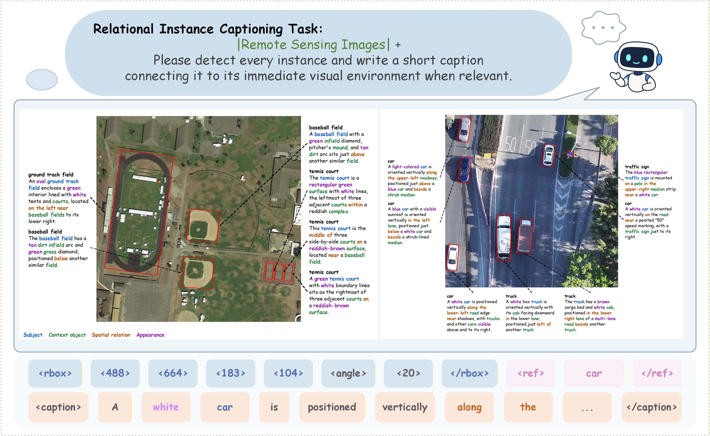

# RICapBench: A Fine-Grained Visual Understanding Benchmark Dataset for Vision-Language Models in Remote Sensing

[🤗 Hugging Face](https://huggingface.co/datasets/yubinux/RICapBench) · [ ModelScope](https://modelscope.cn/datasets/yyyy12306/RICapBench)

## 🌏 Overview

RICapBench evaluates fine-grained visual understanding in remote sensing imagery through instance detection, object-level captioning, and spatial relations. This repository provides model-specific fine-tuning configurations, inference scripts, and the RICScore evaluation toolkit.



*Relational instance captioning in RICapBench. Each instance is localized with an oriented bounding box and described with its appearance and relevant spatial context. The token sequence illustrates the structured output format.*

## 🗂️ Dataset

The dataset is available on [Hugging Face](https://huggingface.co/datasets/yubinux/RICapBench) and [ModelScope](https://modelscope.cn/datasets/yyyy12306/RICapBench).

For the evaluation data format and prediction examples, see the [RICScore input documentation](RICScore/README.md#input).


*Caption generation and spatial relation parser construction. Visual context and object metadata guide instance caption generation; human verification and LLM-assisted review refine parsing rules for extracting spatial relation tuples.*

## 🛠️ Fine-Tuning Configurations

Use the configurations in [`ms-swift-sft-yaml/`](ms-swift-sft-yaml/) with [ms-swift](https://github.com/modelscope/ms-swift) for fine-tuning.

Clone and install ms-swift from source. Run the following commands from the RICapBench repository root:

```bash
git clone https://github.com/modelscope/ms-swift.git
cd ms-swift
pip install -e .
cd ..
```

Choose the YAML file for your model and replace the `/path/to/...` placeholders with your local model, dataset, image, cache, and special-token paths. Adjust `ENV.NPROC_PER_NODE` and the batch size for your available GPUs. The configurations use FlashAttention and log to TensorBoard and Weights & Biases; install the corresponding dependencies and configure logging before training.

For example, fine-tune Qwen3-VL-2B-Instruct from the RICapBench repository root:

```bash
swift sft ms-swift-sft-yaml/Qwen3-VL-2B-Instruct.yaml
```

See the [ms-swift documentation](https://swift.readthedocs.io/en/latest/) for environment requirements and model-specific dependencies.

## 🤖 Inference

The [`closed_models/`](closed_models/) directory contains API-based inference scripts for closed-source models. Pass the evaluation JSONL path with `--dataset` and set the API environment variables required by the selected script. Use `--help` to view the available options.

## 📊 Evaluation

RICScore combines instance detection accuracy, caption quality, and spatial relation F1 into a single score. See the [evaluation guide](RICScore/README.md) for metric definitions, environment setup, input requirements, and evaluation commands.

## Citation

If you use RICapBench in your research, please cite our paper:

```bibtex
@misc{wang2026ricapbench,
  title = {{RICapBench}: A Fine-Grained Visual Understanding Benchmark Dataset for Vision-Language Models in Remote Sensing},
  author = {Xue Wang and Yubin Xu and Kun Tan},
  year = {2026},
  eprint = {2611.16413},
  archivePrefix = {arXiv},
  primaryClass = {cs.CV},
  url = {https://arxiv.org/abs/2611.16413}
}
```

## Acknowledgements

We thank the [ms-swift](https://github.com/modelscope/ms-swift) team for their open-source fine-tuning framework.

## 📜 License

This repository is licensed under the [MIT License](LICENSE).
